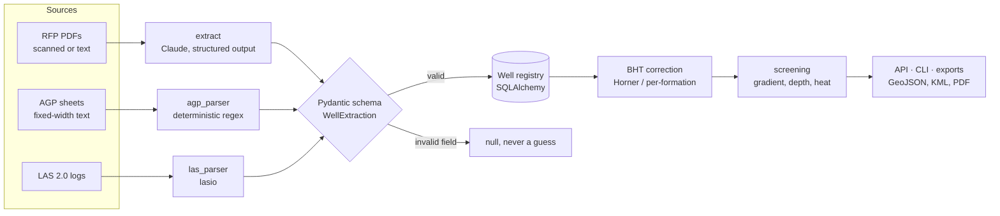

# ResonAnza: architecture

ResonAnza ([resonanza.com.br](https://resonanza.com.br)) reads Brazil's public well records, from oil and gas wells and from water wells, and turns them into data you can trust about subsurface temperature and groundwater. This repository documents the well-record pipeline, starting with temperature. The product code is private; I'm happy to walk through it in an interview.

Built by [Vinícius Freire](https://www.linkedin.com/in/viniciuspaesfreire/) · [portfolio](https://prinny2.github.io) · study stage, no paying customers.

## Two fronts

- **ResonAnza Intelligence**: hydrogeological intelligence (water-risk mapping, screening and aquifer monitoring) built only from measured public data. Open to pilots.
- **ResonAnza Deep**: reading water properties at depth from petroleum well logs. Research in validation; not offered as a product until it passes blind validation and independent review.

Both follow the rule below: every number is labeled measured or modeled, and a modeled number is never presented as a measurement.

---

## The problem

The ANP (Brazil's oil regulator) publishes records for **31,244 wells**. Decades of bottom-hole temperatures, depths and lithology were measured to find oil and were never reread for heat. The catch is the format:

- **RFP reports**: PDFs, many scanned from the 1970s–90s, with misaligned tables and stamps over numbers.
- **AGP sheets** ("Dados Gerais de Poços"): fixed-width text reports, one per well.
- **LAS 2.0 well logs**: ASCII log curves distributed next to the PDFs.
- **Production CSVs**: comma as the decimal separator, dot as the thousands separator, months missing.

The same well can show up in all of them, with different units, datums and depth references.

## Pipeline

1. **Three readers, one contract.** The Claude extractor, the AGP parser and the LAS parser all return the same dict, validated by one Pydantic model (`WellExtraction`). Everything downstream is source-agnostic.
2. **The LLM only reads what has no structure.** AGP sheets are fixed-width text, so they're parsed with regex, no model involved. Claude is used for RFP PDFs, including scanned pages sent as documents, with a JSON schema for the output. Results are cached by hash of PDF + prompt version + model, so a re-run never pays twice.
3. **Validation, then nulls.** The schema rejects physically impossible values (BHT above 400 °C, depth beyond 15 km, latitude without longitude). A field the model wasn't sure about stays `null` and is listed in `campos_baixa_confianca`. Nothing is filled in to look complete.
4. **Deterministic post-processing.** After the model answers, fixed rules run the same way from the CLI and the API: sentinel values become null, the RFP "Temperatures" table is applied without trusting the model's summary, depths are converted from the rotary table to below ground.
5. **Correction and screening.** Bottom-hole temperatures read during drilling are cooler than the rock, because circulating mud cools the hole. They're corrected before any gradient is computed (see below).

A synthetic example of a validated record is in [`example_record.json`](example_record.json).

## Correcting bottom-hole temperature

Paths in order of reliability, each result tagged with the method used:

1. **Horner multi-shot.** Regress BHT against `log10((t_circ + Δt) / Δt)` over several readings at the **same depth**. The intercept (Δt → ∞) is the static formation temperature. Sanity check: the result can't be lower than the highest reading, since mud only cools.
2. **Horner single-shot.** One reading plus circulation and shut-in times, with a regional slope.
3. **Per-formation coefficients, learned.** Wells with a reliable Horner correction train ΔT vs depth per geological formation. The coefficients are then applied to wells in the same formation that lack circulation times. A geologist reviews them instead of supplying them. Two guardrails:
   - Eligibility is recomputed from the raw inputs, never from a stored label, so a stale label can't leak a parametric well into the regression.
   - Empirical-Bayes shrinkage pulls the slope of formations with few wells toward a universal prior, weighted by `n / (n + k)`.
4. **Additive fallback**, explicitly marked as the least reliable.

[`horner.py`](horner.py) is a small standalone version of path 1, written for this repo, with tests in [`test_horner.py`](test_horner.py) (`python -m pytest`).

## Traps found in the source data

Every one of these was confirmed on real wells and is now either a parser rule or a test:

| Trap | What the pipeline does |
|---|---|
| The AGP field labeled "GRADIENTE GEOTÉRMICO" is not a gradient: it's T/Z with no surface reference (e.g. 142.5/1217.5 = 0.117) | Ignored |
| Temperatures whose source reads "DADO NÃO EXISTENTE" or "GRADIENTE REGIONAL" were never measured | Blocklisted by source, not by value |
| AGP repeats one BHT across every logging group, so it looks like multi-shot data but isn't | Reported as a single reading; multi-shot only from LAS/DLIS |
| Readings from different depths don't form a Horner series | Series grouped by depth |
| Depths are measured from the rotary table, not the ground (3.6–8.7 m apart in the wells checked) | Converted with MR − BAP |
| Sentinels: `99:99` as a time, `99/99` as a date, `01/01/1900` | Treated as missing, including any time computed from them |
| Production CSVs: `3.568,041` means 3,568 m³ | Locale-aware parsing |

## Measured vs. modeled

Every number carries its origin. A temperature read in a well is **measured**. A temperature estimated as `T_surface + G_literature × depth` is **modeled**, and recomputing a gradient from it just returns the literature value. That's circular, so modeled numbers are used for depth screening only, never as thermal evidence.

That rule changed the conclusions. In the Recôncavo basin, five wells with logged BHT gave a measured gradient of **24.7 °C/km** (95% CI 21–28). The literature figure was about 38. The measured onshore gradients ruled out power generation (ORC) and moved the focus to direct-use heat, and later to groundwater.

## Interfaces

- **CLI** (Typer): `init`, `extract`, `process`, `pipeline`, `calibrate`, `screen`, `report`, `export`, `status --json`.
- **API** (FastAPI): JWT auth with roles (admin, geologist) and per-IP rate limiting. Endpoints for hotspots, stats, an interactive map, PDF extraction, pipeline runs, GeoJSON/KML export, and a geologist sign-off on each well.
- **Dashboard**: React 19.
- **Field form**: a phone form for community water agents, with per-agent access codes and send limits.

## Stack and operations

Python 3.12, FastAPI, SQLAlchemy, Pydantic, Typer, lasio, pypdf, Anthropic API · SQLite locally, Postgres on Google Cloud Run · React 19 · field form on AWS Lightsail with Docker Compose and Caddy · GitHub Actions running ruff, pytest and coverage · **637 pytest tests**.

---

**Em português:** a ResonAnza lê os registros públicos de poços (os 31.244 poços de petróleo da ANP e os poços d'água do SIAGAS) e transforma relatórios escaneados, fichas AGP e perfis LAS em dados confiáveis de temperatura e de água subterrânea. Duas frentes: a **Intelligence** (risco hídrico e monitoramento com dados medidos, aberta a pilotos) e a **Deep** (a água em profundidade lida nos perfis de petróleo, em validação, não oferecida como produto). Cada número indica se foi medido ou modelado. O código é privado; este repositório explica a arquitetura.
